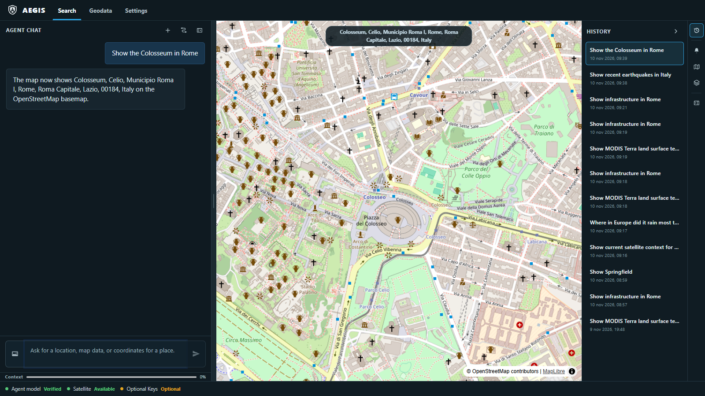
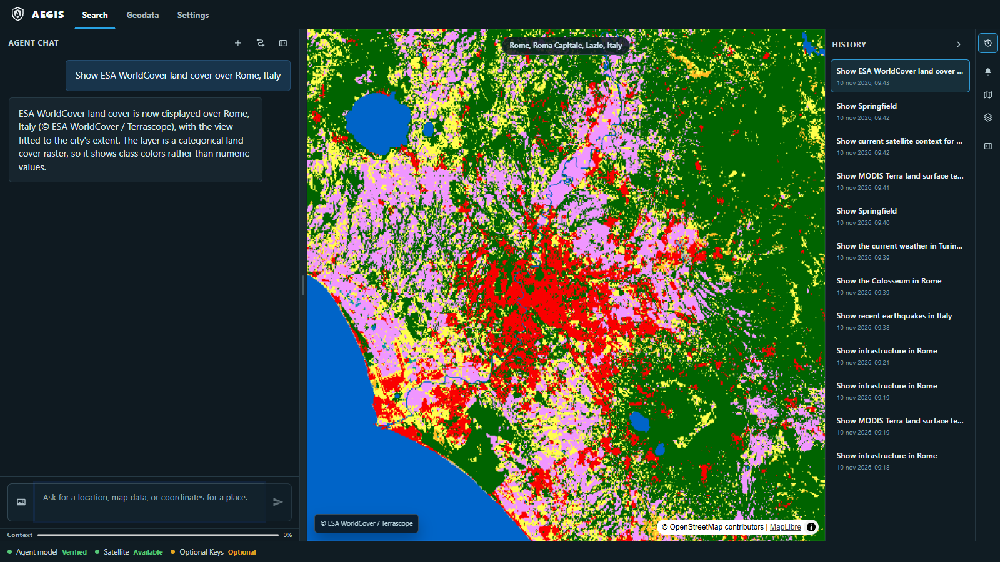

<h1 align="center">AEGIS Geospatial View</h1>

<p align="center">Explore places and geospatial data through chat and a map.</p>

<p align="center">
  <a href="https://github.com/CTCycle/AEGIS-Geospatial-View/stargazers"></a>
  <a href="https://github.com/CTCycle/AEGIS-Geospatial-View/commits"></a>
  <a href="https://github.com/CTCycle/AEGIS-Geospatial-View/releases"></a>
  <a href="https://github.com/CTCycle/AEGIS-Geospatial-View/actions/workflows/ci.yml?query=branch%3Adevelop"></a>
  <a href="LICENSE"></a>
</p>

<p align="center">
  <a href="https://www.python.org/"></a>
  <a href="https://angular.dev/"></a>
  <a href="https://www.microsoft.com/windows"></a>
</p>

<p align="center">
  <a href="#search">Search</a> ·
  <a href="#geodata">Geodata</a> ·
  <a href="#quick-start">Quick start</a> ·
  <a href="#configuration">Configuration</a> ·
  <a href="assets/docs/project_index.md">Documentation</a>
</p>


AEGIS is a local, single-user geospatial workspace. You describe a place or a dataset in chat; an LLM agent picks tools from a catalog of public data sources, fetches the data, and returns an answer together with a map you can inspect. The screenshot above is a real session: a current-weather request for Turin, answered with the model-based reading and its source and time window.

**Status: 1.0.0, source release.** There is no installer or hosted service. AEGIS runs on Windows and needs an LLM (hosted or local) and internet access to the public data providers. The sections below say what has been validated and what has not.

## Search

Ask for a location, coordinates, a regional comparison or a data layer. Follow-ups can refine the request, zoom the map, or add, hide, and remove overlays in the current conversation.

Try:

- `Show current satellite context for Rome, Italy.`
- `Where in Europe did it rain most today?`
- `Show the Colosseum in Rome`
- `Show ESA WorldCover land cover over Rome, Italy`



Regional comparisons are ranked samples or grid bins, reported with source, time window and coverage. Weather grid values are model estimates, not station measurements, and the answer says so. When a request is ambiguous the agent asks and offers clickable answers; here "Springfield" was resolved to Illinois with one click:


Overlays such as land cover, temperature and imagery layers can be added to the same map, with source attribution:



With a vision-capable model you can also attach a photo and ask for location clues; treat the suggested place as a hypothesis.

## What to expect

AEGIS is explicit about failure instead of inventing a result. When a source needs a credential you have not configured (for example EV charging stations via Open Charge Map), it says so and draws no map.

Known limits at 1.0.0:

- **Models.** The agent loop is validated live on OpenCode Go (`deepseek-v4.1-flash`) and, less thoroughly, on `beam-free`. OpenAI and Ollama paths are implemented but have not been validated end to end. The model must support native tool calling and structured output; weaker models fail more often.
- **Reliability.** Results depend on public providers that rate-limit, time out, or return errors (Overpass, FEMA relay and some raster tiles are the least reliable). Agent runs are not deterministic: the same prompt can succeed on one attempt and need a retry or a rephrase on another.
- **Coverage.** Some catalog entries need credentials (Open Charge Map, OpenAQ, TomTom, NASA FIRMS and others). Antimeridian handling is provider-dependent, and multi-layer comparisons are only made when units and time windows are verifiably comparable.
- **Platform.** Windows only; no Docker, Linux or macOS launcher. Narrow viewports below about 1024 px are not a supported layout.
- **Tests.** Not a clean suite: at release, two environment-dependent backend tests (launcher/cache-root checks) and one frontend browser-smoke test (layer reorder) fail; Ruff, strict Pyright and the production build pass. The full validation record is in [project status ledger](assets/docs/project_status_ledger.md).

## Geodata

The catalog lists providers, basemaps, overlays, camera networks, transit feeds, and direct tools. Each entry includes source, coverage or scope, update information, access notes, and dependencies.


Coverage, availability, credentials, quotas, attribution, and reuse terms vary by source. Check the catalog and provider terms before relying on a dataset.

## Quick start

AEGIS currently runs on Windows. Use PowerShell 7 or later and a desktop browser viewport at least 1024 pixels wide. From the repository root, run:

```powershell
.\start_on_windows.bat
```

On first use, the launcher prepares portable Python, `uv`, and Node.js runtimes, synchronizes dependencies, and builds the frontend when needed. It opens the app after the backend is ready. Keep the launcher open while using AEGIS; press **Ctrl+C** to stop it. Run `pwsh .\setup_and_maintenance.ps1` to open the setup and maintenance menu.

Before sending a chat request, select an agent model in **Settings → Models**. The model must support native tool calling and structured output. Install an Ollama model for local use, or configure credentials under **Settings → Model Providers** for a hosted model.

## Configuration

Some geospatial sources need credentials; others are available without a key. Manage source credentials in **Settings → Geospatial Access**. Keys entered in Settings are encrypted in the active SQLite database.

The default data root is `data/runtime`. Set `AEGIS_DATA_DIR` in `settings/.env` to use another location. See the [runtime configuration guide](assets/docs/runtime/configuration.md) for the available settings.

## Development

| Area | Technology |
| --- | --- |
| Web client | Angular and TypeScript |
| API | FastAPI and Python 3.14+ |
| Map | MapLibre GL JS |
| Storage | SQLite and Alembic |
| Windows launcher | PowerShell 7+ |

For manual startup and test commands, see [Runtime startup](assets/docs/runtime/startup.md). The [documentation index](assets/docs/project_index.md) links to architecture, user workflows, and operating guides.

## License

AEGIS Geospatial View is licensed under the [MIT License](LICENSE).

<p align="center"><sub>Last updated: 2026-11-10</sub></p>
