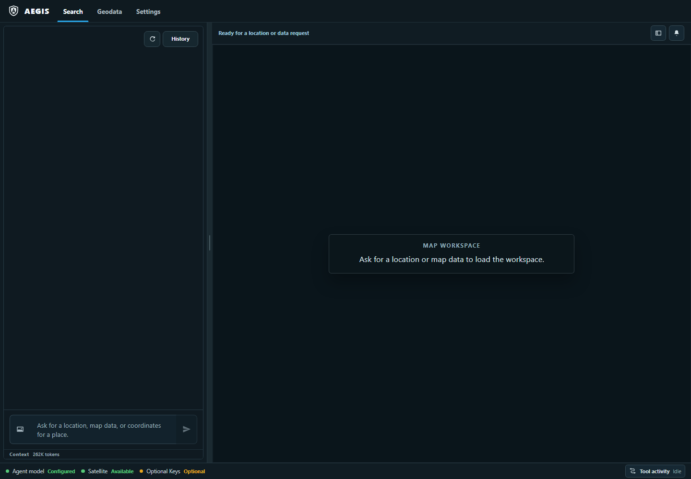
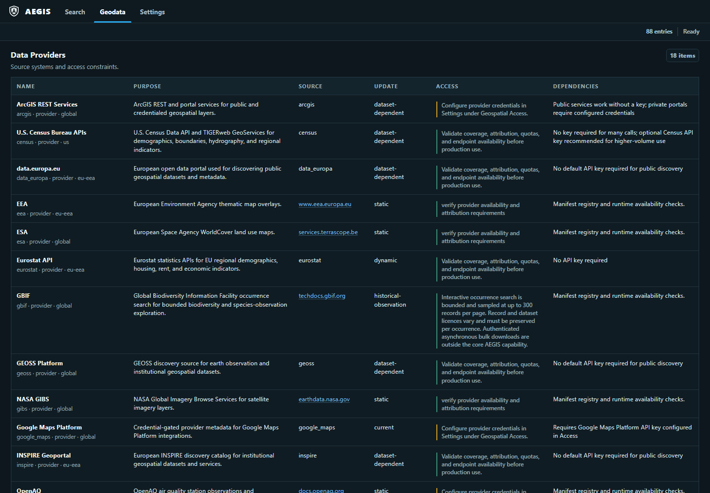

<p align="center">
  
</p>

<h1 align="center">AEGIS Geospatial View</h1>

<p align="center">Ask location and geospatial data questions in chat. Inspect spatial results on a map.</p>

<p align="center">
  <a href="https://www.python.org/"></a>
  <a href="https://angular.dev/"></a>
  <a href="LICENSE"></a>
</p>

## What it does

AEGIS is a local geospatial workspace built around chat and a map. Describe a
place, coordinates, or a data question; the selected model can use the available
geospatial tools and return a written answer, a map session, or both. Follow-up
requests can refine the question or change active overlays while keeping the
conversation context.

The Geodata page catalogs providers, basemaps, layers, camera networks, transit
feeds, and direct tools available to the application. It also shows source and
access notes.

## Screenshots



<sub>Search workspace. Map output appears when a request returns spatial results.</sub>



<sub>Geodata catalog with source, update, access, and dependency details.</sub>

## Capabilities

- Search for places or coordinates and review results in their map context.
- Add, hide, or remove map overlays in follow-up messages.
- Compare conditions across an area with ranked samples or grid bins. Results
  include source and coverage context; weather values are model estimates, not
  station measurements.
- Upload a photo for location clues with a vision-capable model. AEGIS treats
  the result as a hypothesis and asks for confirmation when the clues are
  ambiguous.
- Browse available data sources and manage model and provider access in Settings.

Example requests:

- `Show current satellite context for Rome, Italy.`
- `Where in Europe did it rain most today?`
- `Give me the coordinates of Rome, Italy.`

## Run locally on Windows

The supported Windows launcher requires PowerShell 7 or later. Run it from the
repository root:

```powershell
.\start_on_windows.ps1
```

Choose **Launch application**. On first use, the launcher sets up its portable
Python, `uv`, and Node.js runtimes, synchronizes dependencies, and builds the
frontend when needed. It opens the application when the backend is ready; press
**Ctrl+C** in the launcher to stop it.

Chat requires a model with native tool-calling support. Select an installed
Ollama model in **Settings → Models**, or configure a supported cloud provider
in **Settings → Model Providers**. Basic public geospatial sources do not need
a provider key; some optional sources require credentials or have usage
restrictions.

The application requires a desktop browser viewport at least 1024 pixels wide.
Smaller windows show a minimum-size notice instead of a mobile layout. For
manual development setup and launcher details, see
[Runtime startup](assets/docs/runtime/startup.md).

## Data and configuration

Application data is stored locally in SQLite under `data/runtime` by default.
Set `AEGIS_DATA_DIR` in `settings/.env` to use another data directory. Model
provider keys entered in Settings are encrypted in the local database. See
[Runtime configuration](assets/docs/runtime/configuration.md) for the full
settings reference.

Provider coverage, freshness, credentials, and usage terms vary. Check the
Geodata catalog and each provider's terms before relying on a source.

## Technology

| Area | Stack |
| --- | --- |
| Web client | Angular 22, TypeScript 6 |
| API | Python 3.14+, FastAPI |
| Map | MapLibre GL JS |
| Storage | SQLite, Alembic migrations |
| Windows launcher | PowerShell 7+ |

## Documentation

- [Quick start](assets/docs/user/quick_start.md)
- [User workflows](assets/docs/user/workflows.md)
- [Model and provider settings](assets/docs/user/settings_and_access.md)
- [Runtime startup and development](assets/docs/runtime/startup.md)
- [Configuration](assets/docs/runtime/configuration.md)
- [Troubleshooting](assets/docs/user/troubleshooting.md)

## License

AEGIS Geospatial View is licensed under the [MIT License](LICENSE).
