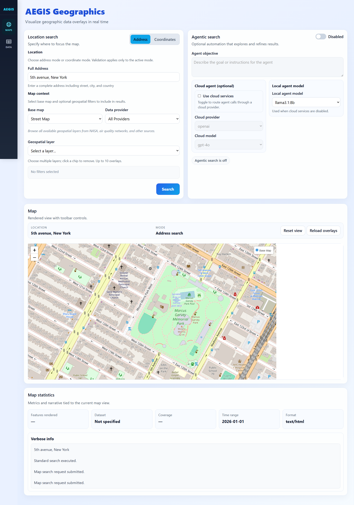
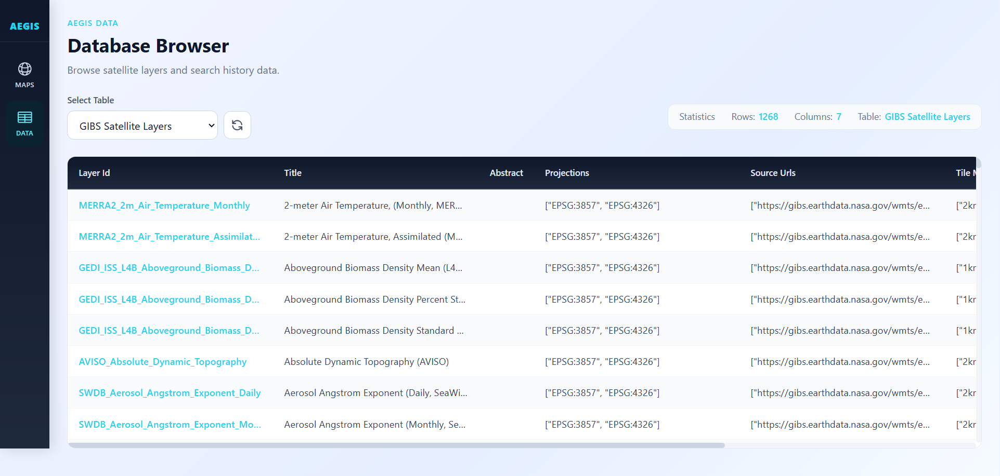

<p align="center"></p>

<h1 align="center">AEGIS Geospatial View</h1>

<p align="center">A chat-driven local geospatial workspace for exploring places, layers, and map context.</p>

<p align="center">
  <a href="https://github.com/CTCycle/AEGIS-Geospatial-View/stargazers"></a>
  <a href="https://github.com/CTCycle/AEGIS-Geospatial-View/commits"></a>
  <a href="https://github.com/CTCycle/AEGIS-Geospatial-View/releases"></a>
  <a href="LICENSE"></a>
</p>

<p align="center">
  <a href="https://www.python.org/"></a>
  <a href="https://angular.dev/"></a>
  <a href="https://www.microsoft.com/windows"></a>
</p>

## Overview

AEGIS turns location questions into map-focused results. Describe a place, coordinates, or a geospatial task in plain language, review the map and available overlays, and refine the result with follow-up requests. The local web application includes a Workspace, a Geodata catalog, and Settings.

The default workflow can use public geospatial sources without a provider key. Optional cloud models and provider services require their own access and availability.

## Key Features

- Search by address or coordinates and review the location in its map context.
- Explore base maps, overlays, and other geospatial capabilities in the Geodata catalog.
- Refine a map session with follow-up requests while preserving conversation context.
- Configure model selection, local Ollama access, provider credentials, and geospatial settings from the application.
- Keep local application state in SQLite, with schema changes managed through Alembic.

## Screenshots

<p align="center">
  <kbd></kbd>
  <kbd></kbd>
</p>
<p align="center"><em>Search page and database browser.</em></p>

## Technology Stack

| Layer | Technology |
|---|---|
| Backend | Python 3.14.7, FastAPI 0.136.3 |
| Web client | Angular 22 (TypeScript 6.0) |
| Database | SQLite (default) |
| Schema migrations | Alembic |
| Launcher | Windows PowerShell with portable Python, uv, and Node.js |

## Installation and Usage

From the repository root in PowerShell, start the launcher:

```powershell
.\start_on_windows.ps1
```

Choose **Launch Application** and open the local address reported by the launcher. On first setup, the launcher prepares the runtimes and dependencies. Use a desktop browser window at least 1024 pixels wide; the interface does not provide a mobile layout.

Manual (from source):

```powershell
cd app/server
uv sync
cd ../client
npm install
```

Then start the backend and client following [Runtime startup](assets/docs/runtime/startup.md).

## Configuration

| Variable | Default | Purpose |
|---|---|---|
| `FASTAPI_HOST` | `127.0.0.1` | Backend host |
| `FASTAPI_PORT` | `5002` | Backend port |
| `UI_HOST` | `127.0.0.1` | Frontend host |
| `UI_PORT` | `5000` | Frontend port |
| `RELOAD` | `false` | Enable backend reload |
| `BACKEND_LOGS_VISIBLE` | `true` | Show backend logs |
| `REALTIME_ALLOW_MISSING_ORIGIN` | `false` | Allow missing-origin WebSocket connections |
| `AEGIS_ALLOW_RESTRICTED_SOURCES` | `false` | Enable restricted public sources |
| `AEGIS_DATA_DIR` | empty | Application data directory override |

Startup and deployment values are stored in `settings/.env`, created from `settings/.env.example` when missing. `AEGIS_DATA_DIR` can select a different local data directory. Enter optional model-provider credentials through **Settings**; the public-source workflow does not require them.

## Documentation

- [Quick Start](assets/docs/user/quick_start.md)
- [Runtime startup](assets/docs/runtime/startup.md)
- [Runtime configuration](assets/docs/runtime/configuration.md)
- [Troubleshooting](assets/docs/user/troubleshooting.md)

## Limitations

- The interface requires a desktop browser window at least 1024 pixels wide; no mobile layout is provided.
- Optional cloud models and provider services require their own access and availability.
- Restricted public sources remain unavailable unless explicitly enabled by the deployment owner.

## Contributing

Contributions are welcome. Open an issue or pull request with a clear description of the change and its motivation.

## License

Licensed under the MIT License. See [LICENSE](LICENSE).
