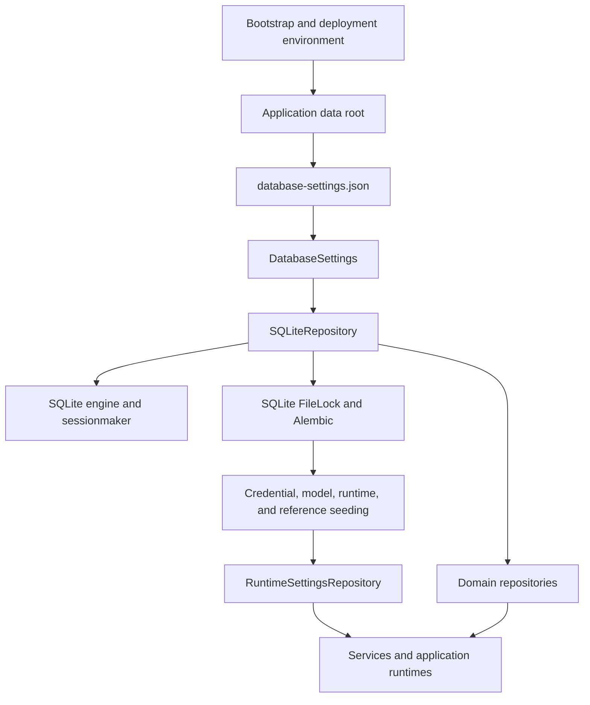

# Persistence

Last updated: 2026-10-21

## SQLite-only relational storage

AEGIS currently supports one relational backend: SQLite. Its connection
configuration is stored in the database-independent file
`database-settings.json` inside the application data root:

- default config: `<repo>/data/runtime/database-settings.json`
- default database: `<repo>/data/runtime/database.db`
- optional data-root override: `AEGIS_DATA_DIR`

The file contains only the backend (`sqlite`), database file path, and SQLite
migration-lock timeout. It is schema-validated, atomically replaced, and keeps
a `.bak` recovery copy. SQLite has no database username or password. All other
user-editable application settings remain in the active database.

`app/server/app.py` and `app/scripts/initialize_database.py` construct one
`SQLiteRepository` directly from `DatabaseSettings`. That concrete object owns
the SQLAlchemy engine and session factory and is passed to domain repositories.
`DatabaseSettings` is loaded from that file before the database is initialized.
There is no alternate backend implementation or driver exposed in Settings.

## Engine and sessions

`app/server/repositories/database/engine.py` is a concrete SQLite helper. Each
connection enables foreign keys, WAL mode, a five-second busy timeout, and
`synchronous=NORMAL`. `check_same_thread=False` is retained because the
application uses a background worker and `asyncio.to_thread`; repositories
still create a short-lived session per operation and never share a session
between requests or threads.

Repository methods own their transaction boundaries. Successful writes commit;
integrity failures roll back before the operation returns an error. SQLite
serializes writers, so transactions remain short and the busy timeout absorbs
normal transient contention. Row-lock APIs that SQLite cannot implement are
not used.

## Initialization and migrations

`app/server/repositories/database/initializer.py` invokes
`migration_runner.py`, then runs the credential and reference-catalog seeders.
Alembic under `app/server/migrations` is the production schema mechanism;
runtime code never calls `Base.metadata.create_all()`.

- an empty file is created at the single current Alembic revision,
  `202608200001`, and seeded;
- an existing file at `202608200001` is validated and seeded idempotently;
- any other or unknown revision fails closed; old schemas require an explicit
  rebuild or a separately reviewed migration before activation;
- a populated file without `alembic_version` fails without stamping or deleting
  data;
- migration and first-start seeding run under a neighboring file lock;
- an existing file is backed up and restored if migration or seeding fails.

Operators must back up a database before deployment. A failed startup never
silently replaces an existing database file.

The canonical schema contains 17 application tables plus `alembic_version`.
Conversations own their context state, message history, message sequence, and
active-run relationship directly; there are no `chat_sessions` or
`conversation_contexts` tables.

## Stored domains

The current relational schema is defined by one squashed Alembic baseline,
`202608200001`. It contains conversations and messages, agent runs and events,
steering messages, model settings, encrypted model credentials, application
runtime settings, and seeded geospatial reference data.
Conversation-scoped native-agent evidence is
stored in compressed `agent_evidence` rows with bounded summaries, provenance,
checksums, and parent references; conversation deletion cascades metadata and
payload. Sequencing, identity, active-run slots,
credential keys, and encryption-material versions are protected by database
constraints. Payload columns use SQLAlchemy `JSON` directly.

The repository/service boundary remains intentional: repositories translate
SQLite/ORM records into domain snapshots, while services own orchestration and
business behavior. Persistence construction remains explicit at the
application composition root. `application_runtime_settings` is the persisted
owner for application-editable runtime blocks. Model preferences, credentials,
and domain data also belong to the selected SQLite database; `.env` contains
only bootstrap and deployment values such as the data root and service ports.

## Runtime database switching

Settings tests the selected SQLite file for integrity and the current Alembic
revision before activation. Empty files are initialized at the baseline;
existing files must already use revision `202608200001`. Unknown or retired
revisions fail closed and require an explicit rebuild or separately reviewed
migration. A candidate runtime is built before the active runtime is replaced;
activation failures restore the previous connection configuration and runtime.
The app rejects a switch while API or WebSocket work or active agent runs are
in flight. Each database retains its own settings and data. Switching does not
copy records between files, and the browser reloads its client stores after a
successful switch. Changing the data-root environment or process-level service
configuration still requires restarting the application.

### Native conversation and presentation contracts

`conversation_state` is persisted and returned only as schema version 2. The
typed contract forbids extra fields, and `pending_clarification` is the sole
durable clarification field. Payloads containing the retired
`unresolved_questions` field or any other unknown field are rejected rather
than migrated. Conversation-state writes validate the typed contract and set
the state revision to the same optimistic context revision that commits the
write.

Agent-run terminal transitions close an in-flight presentation in the same
transaction as the run state. A failed, cancelled, superseded, or timed-out
run cannot leave a `pending` presentation or its `pending_response` behind.
Render timeouts also append a bounded terminal error event in that transaction
so replay retains the causal terminal state.

## Reference catalog policy

Startup orchestration belongs under `app/server/services/catalog/startup.py`.
It invokes the repository seeder after migrations complete.

- static reference data belongs under `data/catalog/reference`;
- loading and parsing belongs under `app/server/services/catalog/loader.py`;
- relational writes belong under `app/server/repositories/catalog/`.

## Frontend persistence

- storage key: `aegis:webapp-ui-state:v1`
- storage type: `sessionStorage`
- TTL: 6 hours
- implementation: `app/client/src/app/core/app-state.ts`

The version 1 frontend state stores chat and settings view preferences only.
Malformed, expired, or unsupported-version state is discarded; there is no
legacy-state migration. Conversation history, active runs, and map sessions
are loaded through their current API contracts rather than this session cache.
